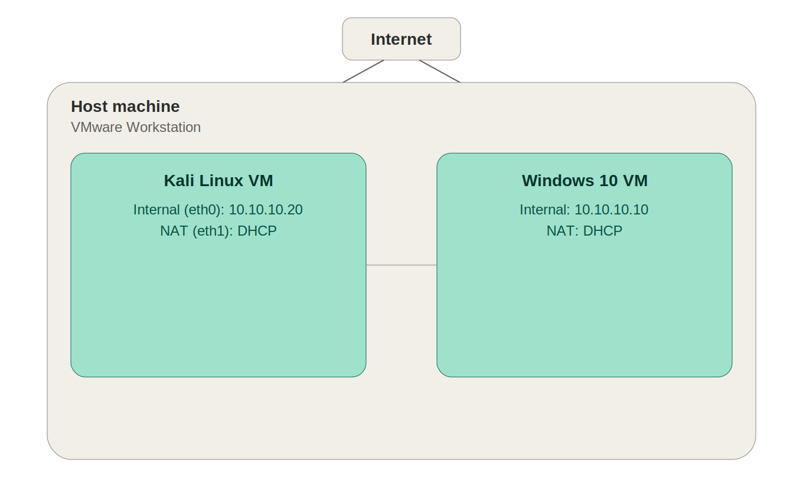
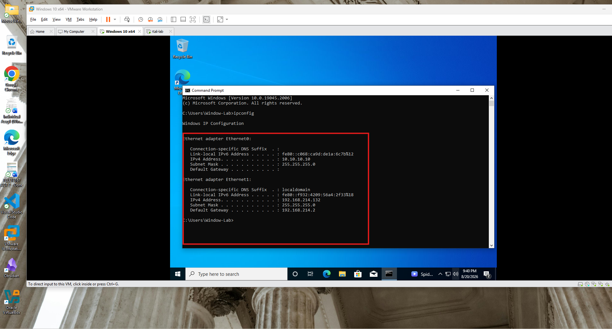
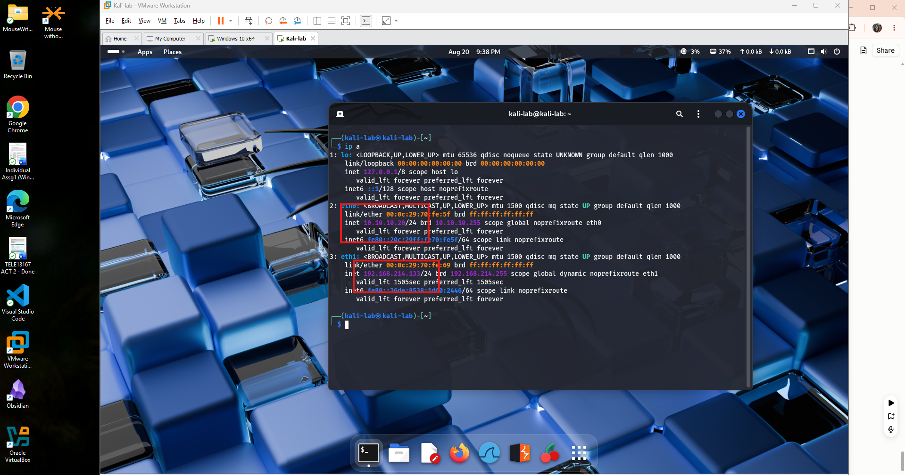
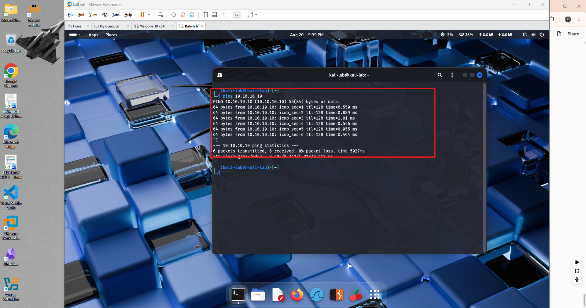
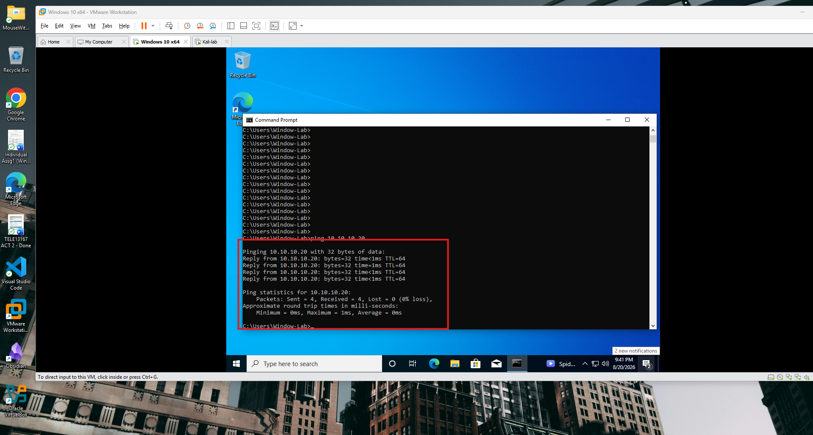

# Project 1: Home SOC Lab Build

**Environment:** VMware Workstation, Kali Linux VM, Windows 10 VM

## Overview

This project stands up the foundational environment for the rest of the home SOC lab portfolio: a Windows 10 VM and a Kali Linux VM running side by side under VMware Workstation, networked so they can reach each other on an isolated internal segment while still keeping internet access for updates and tooling. This document covers the network design, the verification steps taken, and why each configuration choice was made.

## Network diagram

*Each VM runs two adapters: an internal host-only adapter (VMnet2) connecting the two VMs directly on a static 10.10.10.0/24 subnet, and a separate NAT adapter providing independent, DHCP-assigned internet access.*

## Why a dual-adapter design

Each VM was configured with two network adapters instead of one, because a single adapter would have forced a choice between internet access and an isolated lab segment, and this build needed both. The NAT adapter gives each VM its own DHCP-assigned address and a path out to the internet, which is what allowed Windows Update and `apt update`/`full-upgrade` to run on Kali. The second adapter, a custom host-only network (VMnet2), keeps Kali and Windows on their own private segment where they can only talk to each other, completely separate from the host machine's real network or the internet. That separation matters specifically for a SOC lab: later projects involve simulating attacks and generating log data, and that traffic should not touch the home network or the wider internet.

## What each IP address is used for

On the internal segment, Windows was given a static IP of `10.10.10.10` and Kali a static IP of `10.10.10.20`, both on a `10.10.10.0/24` subnet. Static IPs are required here because VMware's host-only network does not hand out DHCP leases the way NAT does, so without manually assigning addresses the two VMs would have no reliable way to find each other. The NAT adapter on each VM, by contrast, receives a DHCP-assigned address automatically from VMware's own NAT service; that address does not need to be known or fixed, since its only job is reaching the internet, not communicating with the other VM.

## Why the golden snapshot matters

Every project after this one builds on top of this environment: installing Sysmon, deploying Wazuh, running attack simulations, and generating logs to analyze. Some of that work is destructive or messy by nature, including malware execution, brute-force attempts, and log tampering for forensics practice, and reinstalling the OS and redoing all of the networking and update work every time something breaks or a fresh scenario is needed would be wasteful. Taking a clean, fully updated, fully networked snapshot now means the environment can be rolled back to a known-good starting point in seconds instead of hours.

## Verification: network configuration

*Windows VM — `ipconfig` confirming Ethernet0 (internal, 10.10.10.10) and Ethernet1 (NAT, DHCP-assigned 192.168.214.132).*

*Kali VM — `ip a` confirming eth0 (internal, 10.10.10.20) and eth1 (NAT, DHCP-assigned 192.168.214.133).*

## Verification: bidirectional connectivity

*Ping from Kali to Windows (10.10.10.10) — 6 packets transmitted, 0% packet loss.*

*Ping from Windows to Kali (10.10.10.20) — 4 packets sent, 0% loss.*

## Done-criteria checklist

- [x] Host virtualization confirmed enabled
- [x] VMware Workstation installed and verified
- [x] Windows VM installed, updated, VMware Tools installed
- [x] Kali VM installed, updated, VMware Tools installed
- [x] Both VMs configured with a NAT adapter and an internal (VMnet2) adapter
- [x] Static IPs assigned and confirmed on the internal segment (10.10.10.10 / 10.10.10.20)
- [x] Bidirectional ping confirmed working
- [x] Golden snapshot (`Clean-Install-Updated`) taken on both VMs
- [x] Environment documentation completed with screenshots, diagram, and written explanation
