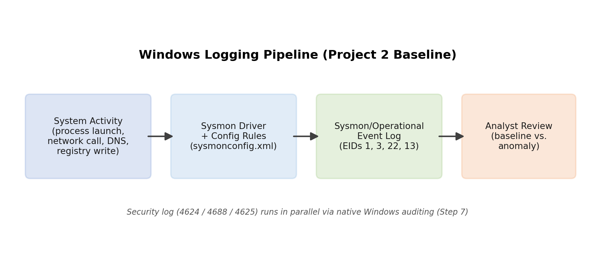
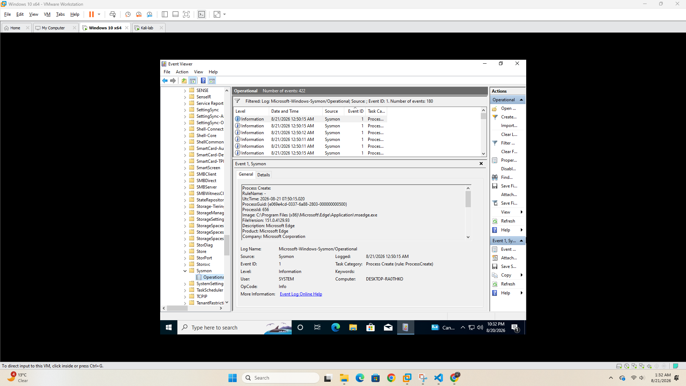
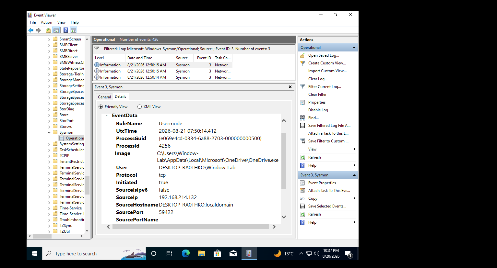
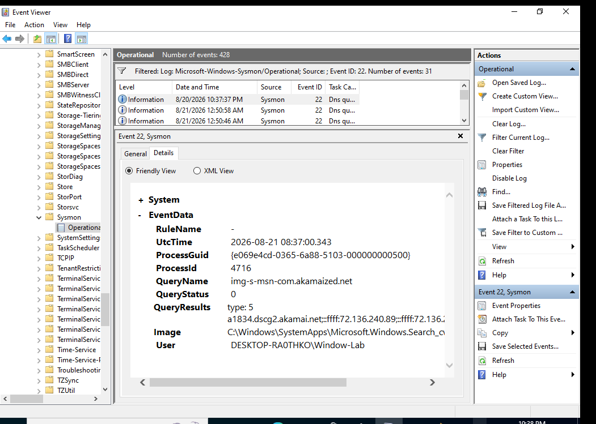
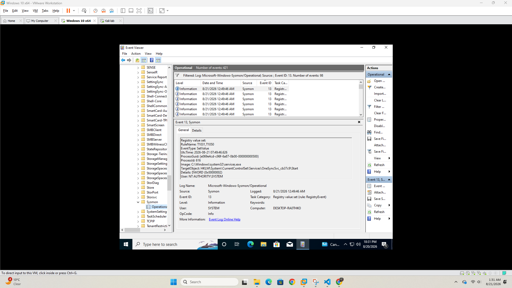
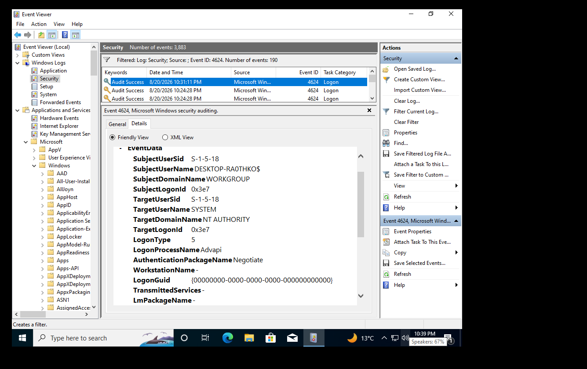
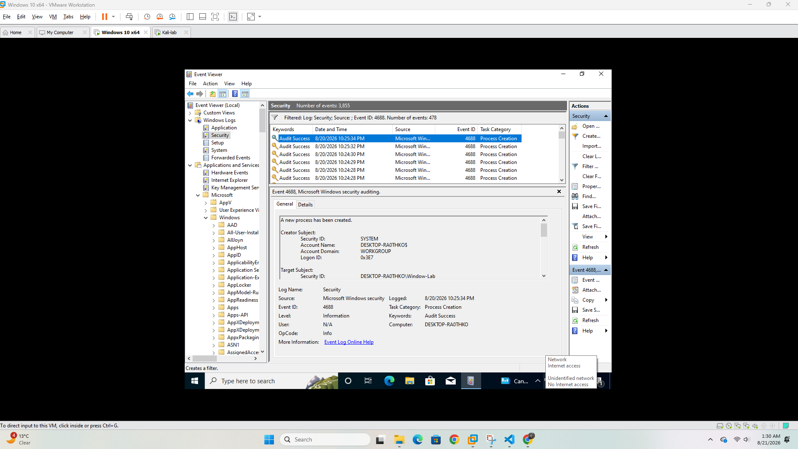
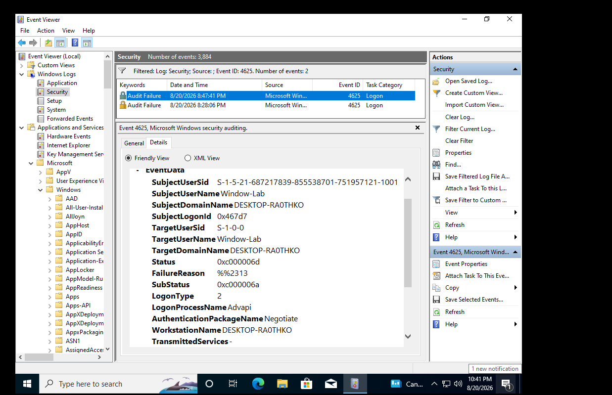
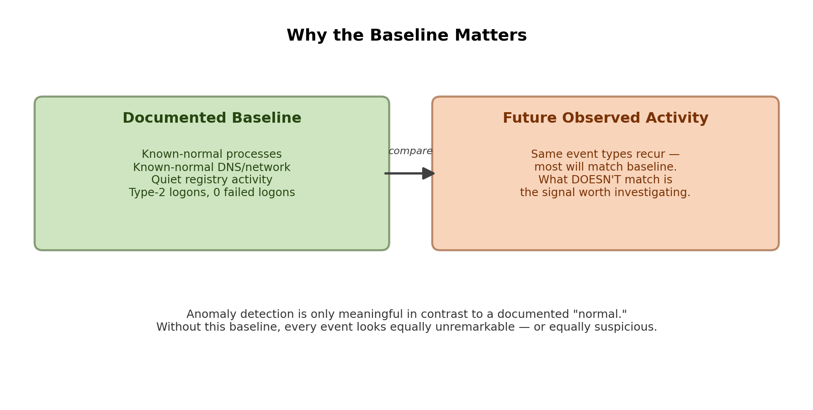

# Project 2 — Windows Logging Baseline with Sysmon

**Environment:** VMware Workstation · Windows 10 x64 · Host `DESKTOP-RA0THKO` · User `Window-Lab`
**Date:** August 20–21, 2026

## Overview

Before any anomaly or attack detection work can mean anything, you need a documented picture of what *normal* looks like on a clean system. This project installs [Sysmon](https://learn.microsoft.com/en-us/sysinternals/downloads/sysmon) with the community-maintained [SwiftOnSecurity config](https://github.com/SwiftOnSecurity/sysmon-config), enables native Windows Security auditing, generates a period of ordinary system activity, and documents the resulting baseline across both logging sources.

This baseline is the reference point every later project in this lab (Wazuh detection, brute-force simulation, log forensics, Sigma rules) will be compared against.

## Setup

- Installed Sysmon 64-bit with the SwiftOnSecurity `sysmonconfig-export.xml` configuration:
  ```
  Sysmon64.exe -i sysmonconfig-export.xml -accepteula
  ```
- Verified service state:
  ```
  sc query Sysmon64   →  STATE: RUNNING
  ```
- Increased max log size on both `Sysmon/Operational` and `Security` logs to prevent early baseline events rotating out.
- Enabled Advanced Audit Policy (via `secpol.msc`) for:
  - **Logon/Logoff → Logon** (Success + Failure) → enables 4624 / 4625
  - **Account Management** (Success + Failure) → enables 4720/4724/4728/4732-type events
  - **Detailed Tracking → Process Creation** (Success) → enables 4688
- Applied policy immediately with `gpupdate /force`.
- Generated a few hours of ordinary activity: browsing, Notepad, File Explorer, Task Manager, Settings, and a logoff/logon cycle.

## Logging Pipeline



A single piece of system activity (a process launching, a DNS lookup, a registry write) is captured by Sysmon's driver against the loaded config and lands in `Sysmon/Operational`. The same activity is separately picked up by native Windows auditing into the `Security` log where the audit policy above is enabled — two independent views of the same ground truth, useful for cross-referencing.

## Sysmon Baseline Findings

| Event ID | Count | What It Captured |
|---|---|---|
| **1** – Process Creation | 180 | Example: `msedge.exe` (Microsoft Edge, Microsoft Corporation) launched during normal browsing. |
| **3** – Network Connection | 3 | Example: `OneDrive.exe` initiating an outbound TCP connection from `192.168.214.132`, port 59422 — routine background sync traffic. |
| **22** – DNS Query | 31 | Example: Windows Search resolving `img-s-msn-com.akamaized.net` (Microsoft/MSN CDN) — routine OS telemetry, not user-initiated browsing. |
| **13** – Registry Value Set | 98 | Example: `services.exe` writing to `HKLM\System\CurrentControlSet\Services\OneSyncSvc_cb37c9\Start` — a routine Windows sync service, not user action. Higher volume than a "should be rare" expectation, but explained by background OS services rather than anything user-driven. |

<details>
<summary>Screenshots</summary>

**Event ID 1 — Process Creation**


**Event ID 3 — Network Connection**


**Event ID 22 — DNS Query**


**Event ID 13 — Registry Value Set**


</details>

## Security Log Baseline Findings

| Event ID | Count | What It Captured |
|---|---|---|
| **4624** – Successful Logon | 190 | Mostly background service logons (`LogonType 5`, SYSTEM). The interactive console logon (`LogonType 2`) from the logoff/logon cycle is confirmed present among the 190. |
| **4688** – Process Creation (native auditing) | 478 | Confirms the Step 7 audit policy took effect. Same underlying activity as Sysmon Event ID 1, seen through Windows' native auditing instead. |
| **4625** – Failed Logon | 2 | Two failed logons for `Window-Lab`, `LogonType 2`, `SubStatus 0xc000006a` (**"wrong password"**). A simple mistyped password on the local console — not an unknown account, not a brute-force pattern. Documented here rather than omitted, to keep the baseline honest. |

<details>
<summary>Screenshots</summary>

**Event ID 4624 — Successful Logon**


**Event ID 4688 — Process Creation**


**Event ID 4625 — Failed Logon**


</details>

## Event ID Reference (What Each ID Means and Why It Matters)

A plain-language cheat sheet for reading these logs, built while working through this baseline.

### Sysmon Event IDs (`Microsoft-Windows-Sysmon/Operational`)

Sysmon doesn't read the Windows logs. It watches the system itself through its own driver and writes its own, more detailed events.

| ID | What It Means | Why It Matters (What Attacks It Catches) |
|---|---|---|
| **1** – Process Creation | A program started. Records full command line, parent process, hash, and user. | The most useful ID. Catches malicious programs, PowerShell abuse, and odd parent-child chains (e.g. `winword.exe` → `powershell.exe`). |
| **3** – Network Connection | A process opened a network connection (source/destination IP and port). | Shows *which program* talked to the internet. Catches malware calling home (C2) and data exfiltration. |
| **5** – Process Terminated | A program stopped. | Helps build a timeline of how long a suspicious process ran. |
| **7** – Image Loaded | A process loaded a DLL. | Catches DLL hijacking/side-loading. Very noisy, so the SwiftOnSecurity config logs little or none of it by default. |
| **8** – CreateRemoteThread | One process started a thread inside another process. | Classic sign of process injection (malware hiding inside a legit process). |
| **10** – Process Access | One process opened another process's memory. | Catches credential dumping, e.g. Mimikatz reading `lsass.exe`. |
| **11** – File Created | A file was created or overwritten. | Catches malware dropping payloads and ransomware writing files. |
| **12 / 13 / 14** – Registry Events | Registry key created/deleted (12), value set (13), key renamed (14). | Catches persistence, e.g. adding a program to `Run` keys so it starts at every boot. |
| **22** – DNS Query | A process looked up a domain name. | Catches connections to malicious domains and DNS tunneling. Ties a domain to the exact program that asked for it. |
| **23** – File Delete | A file was deleted (and optionally archived). | Catches attackers cleaning up their tools or evidence. |

### Security Log Event IDs (`Security`)

These come from Windows' built-in auditing and only appear if the audit policy is turned on (see Setup).

| ID | What It Means | Why It Matters |
|---|---|---|
| **4624** – Successful Logon | An account logged on. | Check the **Logon Type** and **Source Network Address** to tell normal logons from suspicious ones (e.g. RDP from an unknown IP). |
| **4625** – Failed Logon | A logon attempt failed. | Many of these in a short time = brute force or password spraying. Check **Logon Type** and **SubStatus** for the reason. |
| **4634 / 4647** – Logoff | Session ended (4634) or user clicked log off (4647). | Pairs with 4624 to show how long a session lasted. |
| **4688** – Process Creation | A program started (native version of Sysmon ID 1). | Backup view of process activity; useful when Sysmon isn't installed. |
| **4720** – User Account Created | A new local account was made. | Attackers create accounts for persistence. Rare on a normal machine. |
| **4724** – Password Reset Attempt | Someone tried to reset another account's password. | Can mean account takeover. |
| **4728 / 4732** – Member Added to Group | User added to a global (4728) or local (4732) security group. | Watch for users added to **Administrators**, a common privilege escalation step. |
| **4731 / 4735** – Local Group Created / Changed | A local security group was created or modified. | Normal in bursts during Windows setup or first boot; suspicious if it happens later on a settled machine. |

### Logon Types (inside 4624 / 4625)

| Type | Meaning | Example |
|---|---|---|
| **0** | System | Windows creating the SYSTEM session at boot (seen once per startup, with a NULL SID subject) |
| **2** | Interactive | Someone typing a password at the keyboard |
| **3** | Network | Accessing a shared folder (SMB) from another machine |
| **4** | Batch | Scheduled task running |
| **5** | Service | Windows starting a background service |
| **7** | Unlock | Unlocking a locked screen |
| **8** | NetworkCleartext | Network logon with the password sent in clear text (e.g. basic auth) |
| **9** | NewCredentials | `runas /netonly`, using different credentials for network access |
| **10** | RemoteInteractive | Remote Desktop (RDP) |
| **11** | CachedInteractive | Laptop logon using saved credentials when the domain controller isn't reachable |

Type 3 and Type 10 failures from unknown IPs are where network attacks usually show up.

### 4625 SubStatus Codes (Why the Logon Failed)

| Code | Meaning | What It Suggests |
|---|---|---|
| `0xC000006A` | Correct username, wrong password | Typo, or password guessing against a real account |
| `0xC0000064` | Username doesn't exist | Attacker guessing usernames |
| `0xC0000234` | Account locked out | Too many failed attempts already happened |
| `0xC0000072` | Account disabled | Someone trying an old/disabled account |
| `0xC000006F` | Logon outside allowed hours | Policy restriction |
| `0xC0000070` | Logon from a workstation not allowed | Policy restriction |
| `0xC0000071` | Password expired | User needs a password change |
| `0xC0000193` | Account expired | Old account still being tried |
| `0xC000015B` | Logon type not granted | Account not allowed to log on this way (e.g. no RDP rights) |

### Putting It Together: Typo vs. Attack

Counts alone don't tell the story. Reading the fields does.

| | This Baseline | Brute-Force Example |
|---|---|---|
| Count | 2 failures | 500 failures in 5 minutes |
| Logon Type | 2 (at the keyboard) | 3 (network) or 10 (RDP) |
| SubStatus | `0xC000006A` (wrong password) | Mix of `0xC0000064` and `0xC000006A` |
| Account | `Window-Lab` (own account) | Many usernames, or `Administrator` |
| Source | Local console | Unknown external IP |
| **Verdict** | **Mistyped password** | **Password guessing attack** |

## Why This Baseline Matters



None of the individual events above mean much on their own — a process launching, a registry key being written, a logon succeeding are all things that happen constantly on any working machine. What turns them into something useful is having this record of what counts as *ordinary*, on this machine, under normal conditions, before anything unusual has happened. Every project after this one depends on that contrast: a brute-force attempt only looks abnormal because we now know the normal failed-logon count is just two mistyped passwords; a suspicious parent-child process relationship only stands out because we've seen what `notepad.exe` launching under `explorer.exe` looks like when nothing is wrong. Documenting the baseline first is what makes anomaly detection possible later, rather than guessing at what looks "off" without anything to compare it to.

## Status

- [x] Sysmon installed with SwiftOnSecurity config, service confirmed running
- [x] Log sizes increased, Advanced Audit Policy configured
- [x] Baseline activity generated and reviewed across Sysmon (1, 3, 13, 22) and Security (4624, 4625, 4688)
- [x] Findings documented with evidence
- [ ] Snapshot `Sysmon-Configured-Baseline` taken — pending

**Next project:** Wazuh SIEM setup and detection, built on top of this baseline.
